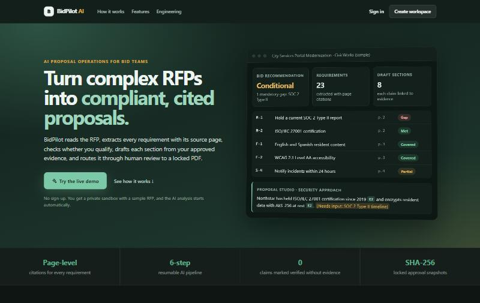
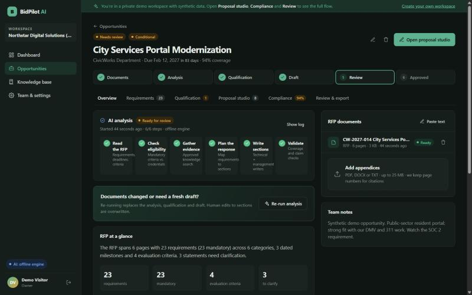
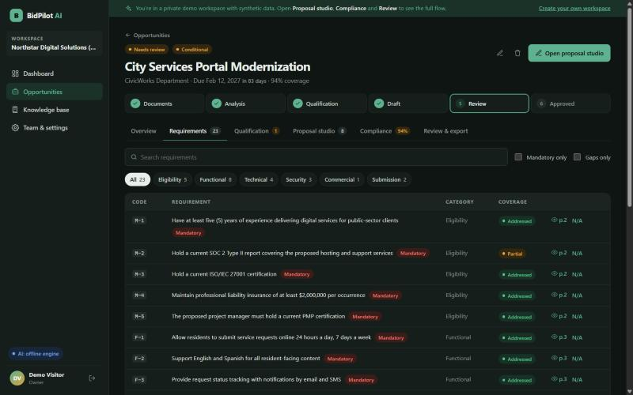
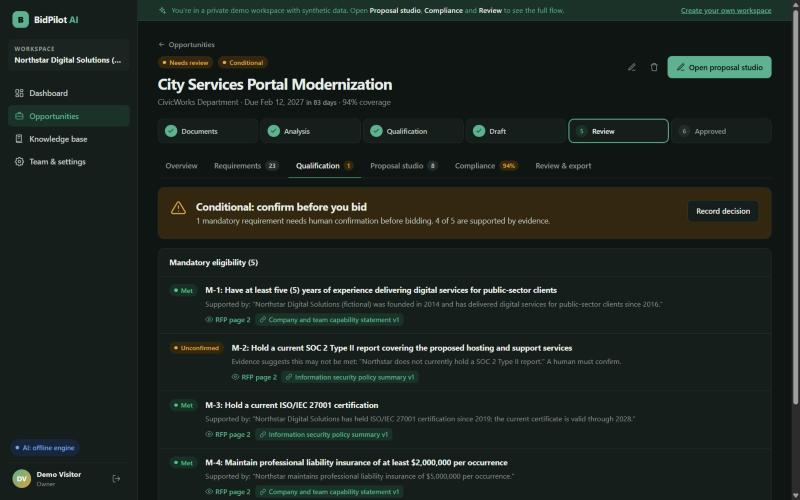
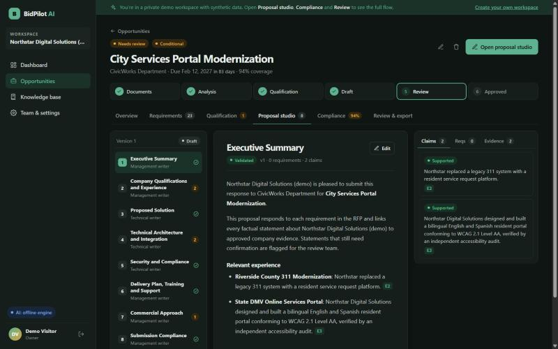
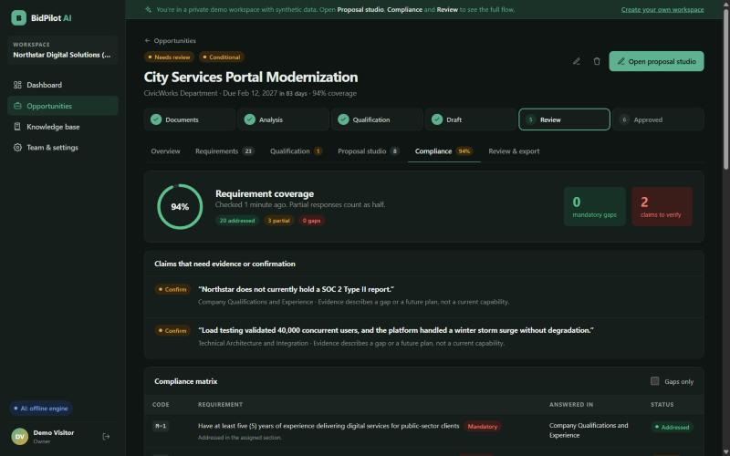
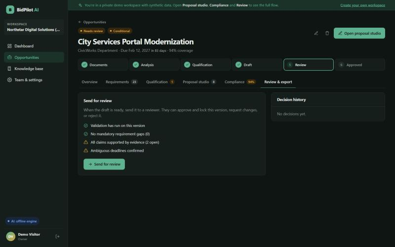

# BidPilot AI

**Turn complex RFPs into compliant, evidence-backed proposals.**

BidPilot reads an RFP, extracts every requirement with its source page, checks your eligibility against approved company credentials, drafts every proposal section with citations to your own evidence, verifies coverage and claims, and routes the result through human review to a locked, checksummed PDF.

     



> Demo data is fully synthetic (fictional *CivicWorks Department* and *Northstar Digital Solutions*). No metrics in this repo are measured product results.

## Try it in one click

Run it locally (below), open http://localhost:3000 and press **Try the live demo**. No sign-up is needed. You get a private sandbox workspace, the sample RFP loads, and the AI analysis starts automatically.

## What it does

| | |
|---|---|
|  |  |
| **Opportunity workspace.** A six-stage pipeline with live progress, from documents to approval. | **Requirements.** Each one is extracted with its category, mandatory flag, source page and coverage. |
|  |  |
| **Qualification.** Mandatory criteria are checked against approved evidence. The missing SOC 2 report is caught before writing starts. | **Proposal Studio.** Sections are drafted by technical and management writers. Every claim links to the evidence that supports it. |
|  |  |
| **Compliance.** Coverage score, claims that need confirmation, and a full requirement-to-section matrix. | **Review and export.** Readiness checks, reviewer decisions, a locked SHA-256 snapshot and a PDF export. |

## Highlights for reviewers

- **Grounded AI, not a chat wrapper.** Model output is schema-validated (Zod). Quotes are checked against the source pages, and citations must resolve to approved evidence. A claim without evidence can never be marked "supported".
- **Model-agnostic.** Claude (structured outputs, adaptive thinking), any OpenAI-compatible API (Gemini, Groq, OpenRouter, Ollama), or a deterministic offline engine for CI and demos.
- **Real backend engineering.** Three services, a persisted and resumable workflow graph, multi-tenant RBAC, an audit log, versioned knowledge, immutable approvals, and PDF rendering.
- **Production account features.** Email verification, password reset, email invitations, role management, rate limiting and security headers.
- **Tested.** Contract, API and pipeline tests run on real PostgreSQL (PGlite) in GitHub Actions.

## Quick start (no Docker, no API key)

Requirements: **Node.js 20.12+**.

```bash
npm install
npm run dev
```

Open http://localhost:3000 and click **Try the live demo**. Or create a workspace, click **Load sample workspace**, then **Analyze RFP**. Within seconds you'll see:

- 23 requirements extracted with page citations, and an ambiguous deadline flagged for confirmation
- A **Conditional** bid recommendation, because the sample company lacks the required SOC 2 Type II report
- Eight drafted sections from parallel technical and management writers, each claim linked to approved evidence
- A compliance matrix, claim verification, review and approval, and a locked PDF export

`npm run dev` starts three services with prefixed logs:

| Service | Port | What it does |
|---|---|---|
| `apps/web` | 3000 | Next.js app (proxies `/api/v1` to the API, so the session cookie works without CORS) |
| `apps/api` | 3001 | NestJS business API: auth, tenancy, RBAC, documents, knowledge, workflows, proposals, audit, PDF export |
| `apps/ai-orchestrator` | 8000 | Runs the persisted AI step graph: analysis, qualification, retrieval, planning, writing, validation |

With no `DATABASE_URL`, the API uses **embedded PGlite** (real PostgreSQL compiled to WASM), stored in `apps/api/.data/`. Delete that folder to reset.

## Turn on Claude

Copy `.env.example` to `.env` and set `ANTHROPIC_API_KEY`. The orchestrator then uses `claude-opus-5-5` with structured outputs, adaptive thinking, and server-side refusal fallback. Without a key it runs a deterministic **offline engine**: it only restates the RFP, quotes approved evidence, and flags everything else for a human. The sidebar shows which engine is active, and each run shows token usage and estimated cost.

### Free models for testing

Any OpenAI-compatible API works through the same prompts and schema validation. Put **one** key in `.env` (leave `ANTHROPIC_API_KEY` empty) and restart `npm run dev`:

| Provider | Variable | Get a key | Default model |
|---|---|---|---|
| Google Gemini (free tier) | `GEMINI_API_KEY` | https://aistudio.google.com/apikey | `gemini-flash-latest` |
| Groq (free tier) | `GROQ_API_KEY` | https://console.groq.com/keys | `openai/gpt-oss-120b` |
| OpenRouter (`:free` models) | `OPENROUTER_API_KEY` | https://openrouter.ai/keys | `openrouter/free` (auto-picks a free model) |
| Ollama (local, no key) | `LLM_PROVIDER=ollama` | https://ollama.com | `llama3.1` |

Free model catalogs change often; if a default is retired, set `LLM_MODEL` to a current one. Override the model with `LLM_MODEL`, or point at any other server with `LLM_BASE_URL` + `LLM_API_KEY`. Free tiers have tight rate limits; the step runner retries 429s, but long RFPs may take a while. Free-tier prompts may be used by the provider for training, so test with the synthetic sample data, not real client documents.

## Production-like stack (Docker)

```bash
docker compose up --build
```

This runs PostgreSQL (pgvector), the API, the orchestrator and the web app. Set `INTERNAL_SERVICE_TOKEN` and `ANTHROPIC_API_KEY` in your environment first. Redis and MinIO are available behind `--profile infra` for upcoming phases.

## How it works

```
Upload / paste RFP ─► page records (checksum, page numbers, empty-page detection)
        │
        ▼  POST /opportunities/:id/analyze  (API persists workflow + steps, dispatches)
AI orchestrator ── reads context, writes each step result back through /internal/* ──► API (owns all writes)
  1 analysis       requirements, deadlines, criteria, ambiguities; quotes verified against pages
  2 qualification  mandatory eligibility vs. approved evidence → deterministic go / conditional / no-go
  3 retrieval      tenant + approval-filtered Postgres full-text evidence search
  4 planning       sections; deterministic guard ensures every requirement has an owner
  5 writing        technical + management writers in parallel; citations [E#] mapped to evidence ids
  6 validation     coverage per requirement; claims without resolvable evidence can never be "supported"
        │
        ▼
Human review ─► approve (immutable snapshot + SHA-256) ─► PDF rendered only from that snapshot
```

**Guarantees built into the code:**
- **Tenant isolation.** The organization always comes from the session membership, never from request bodies or model output. Every query is organization-scoped.
- **Human authority.** The AI recommends. Bid overrides need a reason. Approval needs a reviewer role and a rationale when gaps remain. Every decision is in the audit log.
- **Resumability.** Step outputs are checkpoints. A reconciler re-dispatches stale work after restarts, and the runner skips completed steps.
- **Versioned evidence.** Editing knowledge creates a new draft version. Only the current approved version is searchable, and old chunks remain resolvable.
- **Immutable approvals.** Any edit after approval creates a new version and voids the approval. Exports are idempotent per approval.

## Roles

| | Owner | Admin | Proposal manager | Contributor | Reviewer |
|---|:-:|:-:|:-:|:-:|:-:|
| Run AI and edit drafts | ✓ | ✓ | ✓ | ✓ | |
| Manage knowledge | ✓ | ✓ | ✓ | | |
| Approve knowledge | ✓ | ✓ | | | |
| Approve proposals | ✓ | ✓ | | | ✓ |
| Manage members | ✓ | ✓ | | | |

## Accounts and email

Teammates join by **email invitation** (Team & settings → Invite member). New accounts confirm their email, and anyone can reset a forgotten password from the sign-in page. Reset links are single-use, expire after 1 hour, and sign the user out on every device.

Without `RESEND_API_KEY`, emails are printed to the API log (look for `──── email`), so you can click the links locally. To send real email, create a free [Resend](https://resend.com) key, verify your sending domain, and set `RESEND_API_KEY`, `MAIL_FROM` and `APP_URL` (the public web URL used in links).

Sign-in, sign-up, password reset and invitation routes are rate-limited per IP address and per email. The limiter is in memory, so if you run more than one API replica, move it to Redis.

The one-click demo (`POST /api/v1/demo/start`) creates a separate throwaway workspace per visitor and is limited to 5 per IP per hour. Set `DEMO_ENABLED=false` to turn it off on a real deployment.

## Development

```bash
npm test          # contracts, API (incl. tenant isolation on PGlite) and orchestrator pipeline tests
npm run typecheck
npm run build
```

Project layout: `packages/contracts` (versioned Zod contracts and shared rules), `apps/api`, `apps/ai-orchestrator`, `apps/web`, `docs/PLAN.md` (decisions, deviations from the blueprint, roadmap).

If Next.js reports a missing chunk such as `Cannot find module './592.js'`, stop the dev server, delete `apps/web/.next`, and restart.
